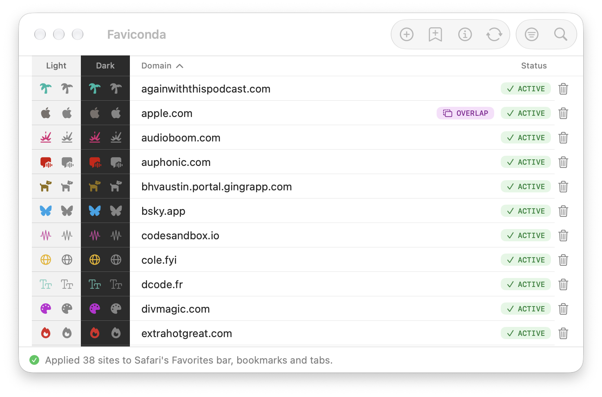

# Faviconda

Choose the icon Safari shows for any website.

Faviconda is a Mac app that puts your own icons on sites in Safari's Favorites bar, bookmarks and tabs. Safari has no setting for this.

**[Download the latest version](https://github.com/SixDemonBag/faviconda/releases/latest/download/Faviconda.dmg)** · [All releases](https://github.com/SixDemonBag/faviconda/releases)

## Install

1. Open `Faviconda.dmg` and drag Faviconda into Applications.
2. Open Faviconda from Applications.
3. Give it **Full Disk Access** in System Settings > Privacy & Security > Full Disk Access. Safari keeps its icons in a folder macOS protects, and Faviconda needs this to read and write there.
4. In Safari, go to Settings > Extensions, turn on **Faviconda**, and allow it on all websites. Do this in every Safari profile you use. The app reminds you if it's off.

Requires macOS 14 or later. Built and tested on macOS 27.

## Use

1. Add a site from your bookmarks, or type its address.
2. Choose an image, or drop one onto the site's row.
3. Click **Apply to Safari**. Safari quits, your icons are written, and Safari reopens.

Each site shows a badge saying whether Safari is showing your icon. Faviconda stays in the menu bar and puts your icons back whenever Safari replaces them. Your icons can also be shown in grayscale.

## Privacy

Faviconda works with files on your Mac. It has no accounts, analytics or crash reporting. Its only network request is a daily check here for a newer version, which sends nothing about you or your sites and can be turned off in Settings. It reads Safari's icon cache and bookmarks, and changes only the icon cache.

[Everything Faviconda does on your Mac, and why](PRIVACY.md)

## Updates

When a new version is out, Faviconda shows a banner with a link to it. Download it and open it, and it replaces your current copy. Your sites and icons are kept.

## Removing Faviconda

1. Remove all your sites in Faviconda and click **Apply to Safari**, so Safari gets every site's own icon back.
2. Quit Faviconda from its menu bar icon, and delete it from Applications.
3. Delete `~/Library/Application Support/Favicons` and `~/Library/Containers/fyi.cole.safari-favicons.SafariExtension`.
4. Remove Faviconda from Full Disk Access in System Settings.

## Feedback

Found a problem or have an idea? [Open an issue](https://github.com/SixDemonBag/faviconda/issues).
